# All In Analytics — User Onboarding Guide

All In Analytics tracks a home Texas Hold'em game as it is played: who has which
cards, who bet what, who won — and then lets you replay the session on a 3D table
and look at the numbers.

One person **deals** (the dealer runs the game from their phone), everyone else
**plays** (each player joins from their own phone). This guide follows a single
mock hand from start to finish. Every screenshot is from a real run of the app
with made-up players — Ava, Ben, Cleo and Dan.

---

## The flow at a glance

```
Dealer creates a game ──► Dealer starts a hand
                                   │
        every player photographs their hole cards on their own phone
                                   │
                  betting (the app says whose turn it is)
                                   │
        dealer photographs the flop ─► betting ─► turn ─► betting ─► river ─► betting
                                   │
        dealer taps Finish Hand ─► checks the payout preview ─► saves
                                   │
              next hand … … … ─► End Game ─► replay & stats
```

Everything is live: when anyone does anything, every other screen updates within
a moment — nobody needs to refresh.

---

## Getting connected

The host runs the app on one machine on the local network. Everyone else opens
it in a phone browser.

| What | Address |
|------|---------|
| The app | `https://aia.local` |
| If `aia.local` doesn't resolve on your phone | `https://<host-ip>` (ask the host) |
| API documentation | `https://aia.local/docs` |

**First time on a phone — trust the certificate (once per phone).** The app is
served over HTTPS so the camera works. The certificate is made by the host, so
your phone warns about it until you install it. See
[local-network-setup.md](local-network-setup.md) for the host's side; on the
phone:

1. Open the certificate download link the host gives you (`aia-local-ca.crt`).
2. **iPhone / iPad:** allow the download, install it under *Settings → Profile
   Downloaded*, then switch it on under *Settings → General → About →
   Certificate Trust Settings*.
   **Android:** open the downloaded file (or *Settings → Security → Install a
   certificate → CA certificate*) and confirm.
3. Open `https://aia.local` again — no more warning.

> You can tap through the warning instead, but some browsers will not let a
> page use the camera until the certificate is trusted.

---

## Walkthrough: one hand, start to finish

### 1. Create the game (dealer)

On the dealer's phone open **Dealer** from the top bar. The first screen lists
existing games; tap **+ New Game**.

<table><tr>
<td>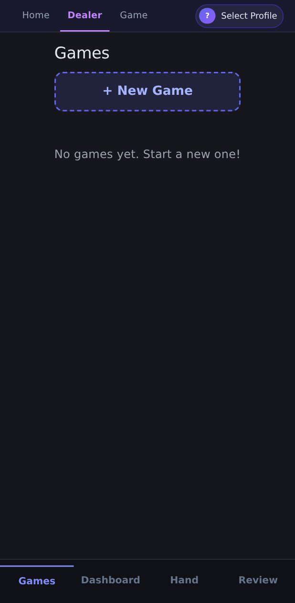</td>
<td>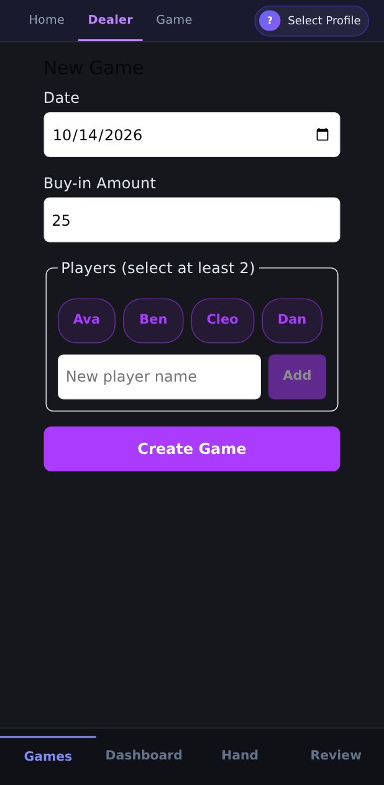</td>
</tr></table>

- Pick the **date**, set the **buy-in** (every player starts with this stack),
  and add the **players**: type a name and tap **Add**. People who have played
  before can be picked from the list.
- Tap **Create Game**.

### 2. Set the table and start a hand (dealer)

You land on the game's **dashboard**: every player with their stack, their seat
number, a **Buy Back** button for re-buys, and an **Active** switch to sit
someone out.

<table><tr>
<td>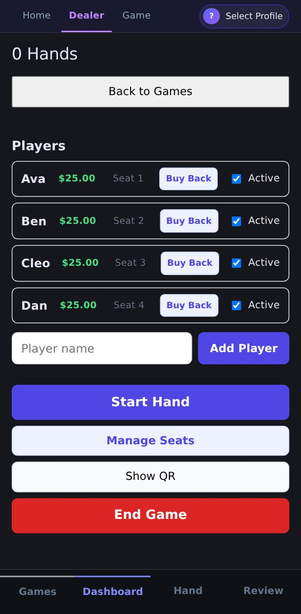</td>
<td>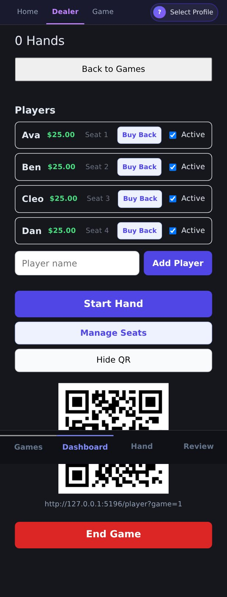</td>
</tr></table>

- **Show QR** displays a code players can scan to open the game on their own
  phone, so nobody has to type an address.
- **Manage Seats** rearranges who sits where (this sets the order of play).
- **Start Hand** deals the next hand. The blinds (`$0.10 / $0.20` here) move
  around the table automatically.

After **Start Hand** the dealer's screen shows the hand, and every player is
**Pending** until they have shown their hole cards.

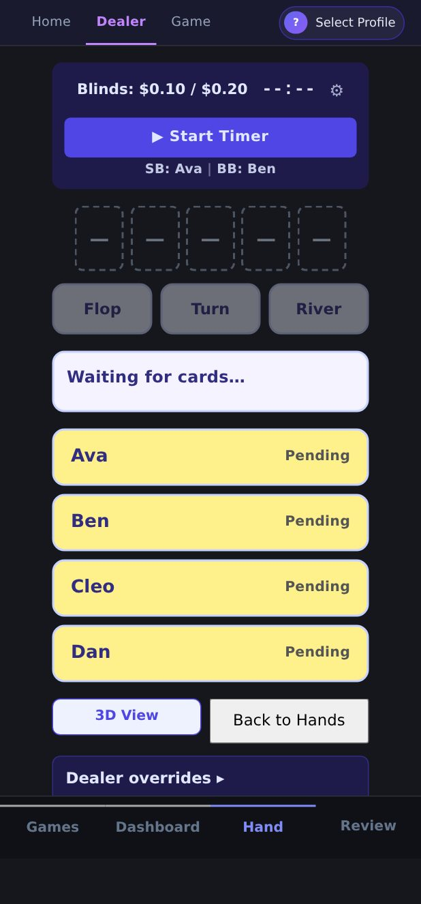

> The blind timer (**▶ Start Timer**) is optional — it counts the blind level
> down so you can raise the blinds on schedule.

### 3. Players join (each player)

On their own phone each player opens **Game** from the top bar and taps the
game the dealer started. Then they choose who they are: **Select Profile** at
the top right → **Switch Profile** → your name.

<table><tr>
<td>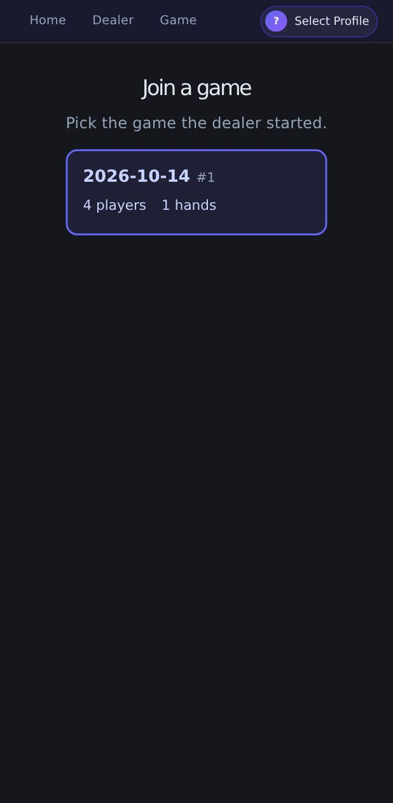</td>
<td>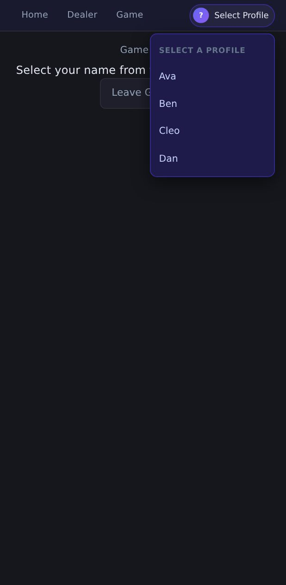</td>
</tr></table>

Your name is remembered on that phone for the night. The top of your screen
shows your name and your **Stack**.

### 4. Players capture their hole cards (each player)

When a hand starts your screen says **"Your turn! Capture your cards."** Tap
**Capture Cards**.

<table><tr>
<td>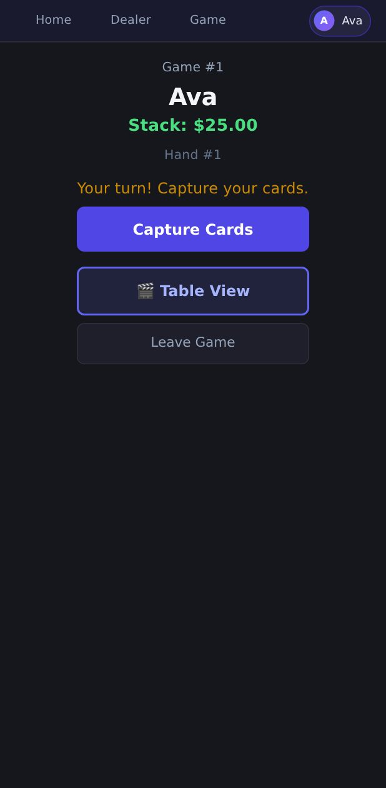</td>
<td>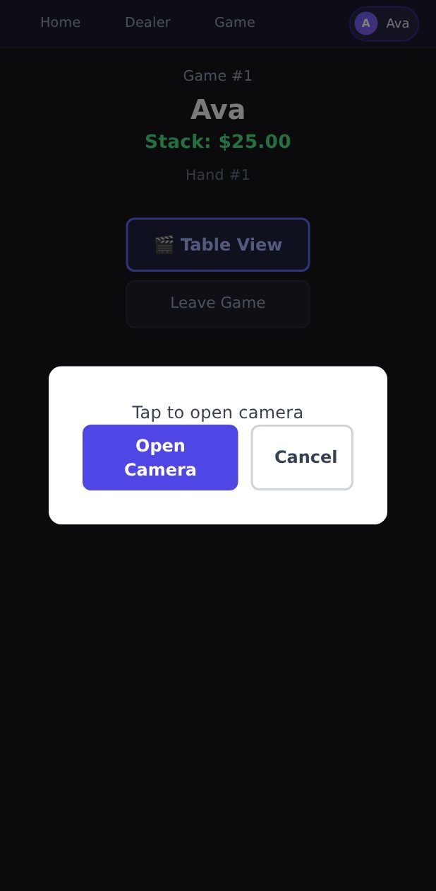</td>
<td>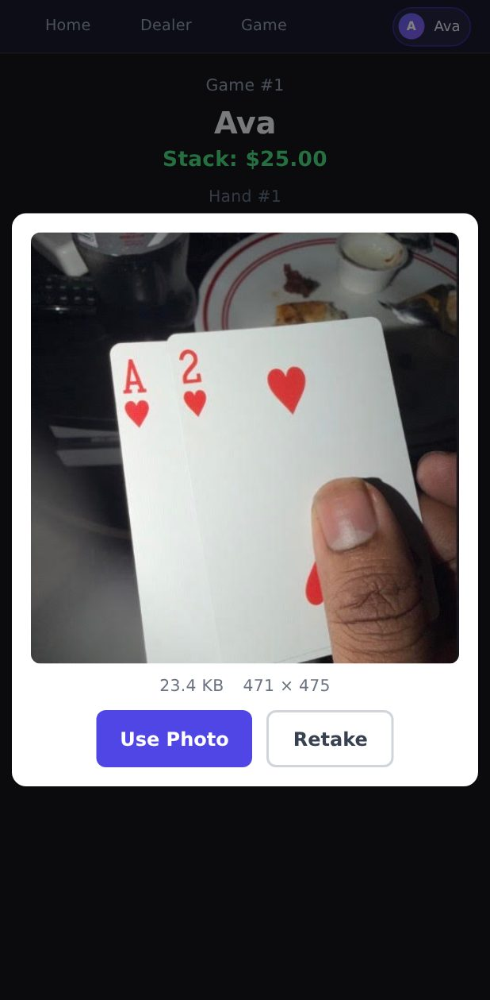</td>
</tr></table>

1. Tap **Open Camera** and photograph your two cards face-up, close and
   steady, with the rank and suit corners visible.
2. Check the preview — **Use Photo** or **Retake**.
3. The app shows the cards it recognised with a confidence percentage. If one
   is wrong, correct it or **Retake**.
4. Tap **Confirm**.

<table><tr>
<td>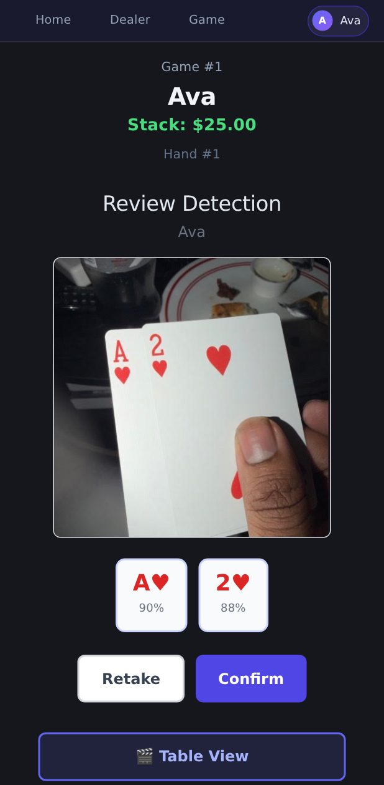</td>
<td>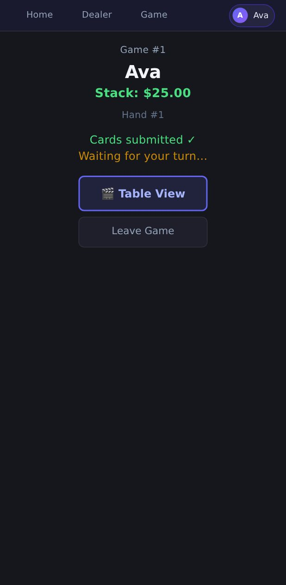</td>
</tr></table>

Your screen now says **"Cards submitted ✓ — Waiting for your turn…"**. Other
players never see your cards on their phones.

### 5. Betting: whose turn it is

The dealer's screen always says whose turn it is and what they may do. The
player whose turn it is gets their buttons.

<table><tr>
<td>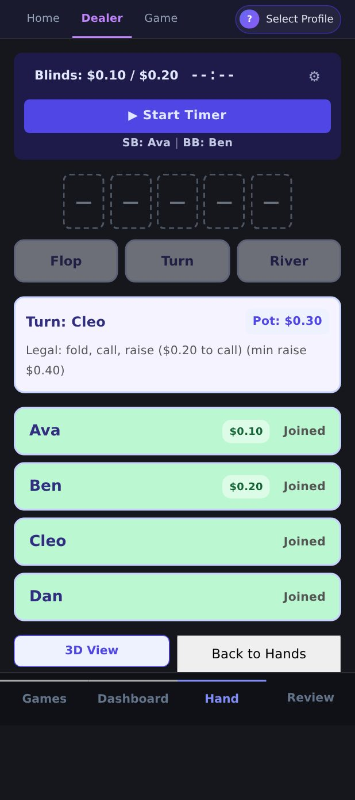</td>
<td>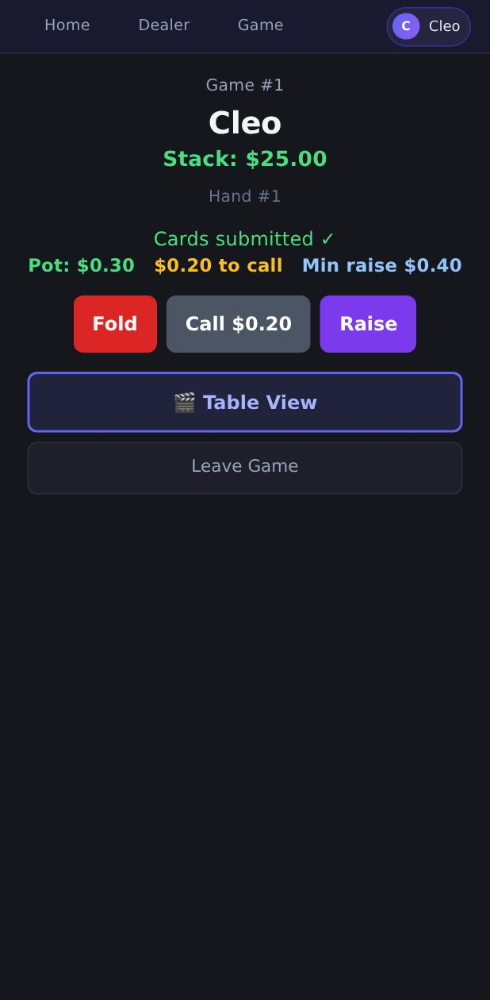</td>
</tr></table>

The player sees **Fold**, **Check** or **Call $x**, and **Bet** or **Raise**,
with the **pot**, the **amount to call** and the **minimum raise** above them.

To bet or raise, tap **Raise**, tap chips to build the amount, then **Bet** to
confirm. **All In** puts in the whole stack; **Clear** starts the amount again.

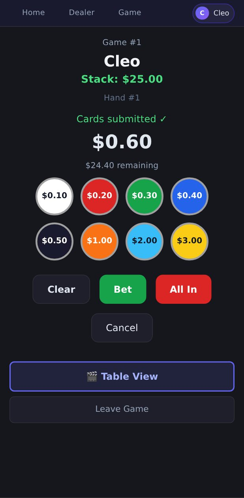

The app does not let anyone act out of turn, bet more than they have, or raise
by less than the minimum — it tells them why instead.

### 6. Deal the flop, turn and river (dealer)

When everyone has acted and the bets are level, the dealer's screen says what
to do next:

> **✅ Betting complete — deal the flop**

(If every remaining player is genuinely all-in it says so instead, and no
further betting happens.)

Tap **Flop**, photograph the three cards, check what was recognised and
**Confirm**.

<table><tr>
<td>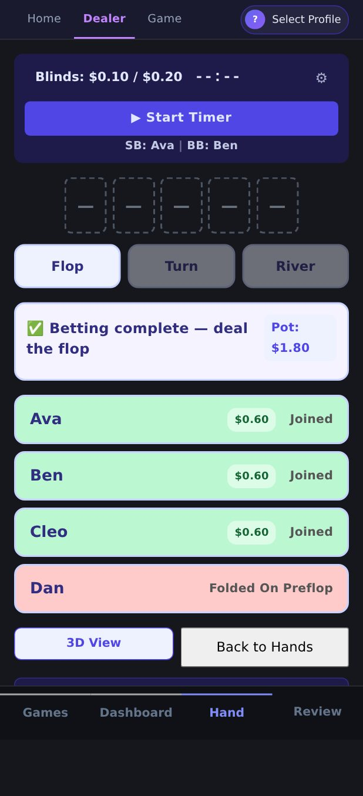</td>
<td>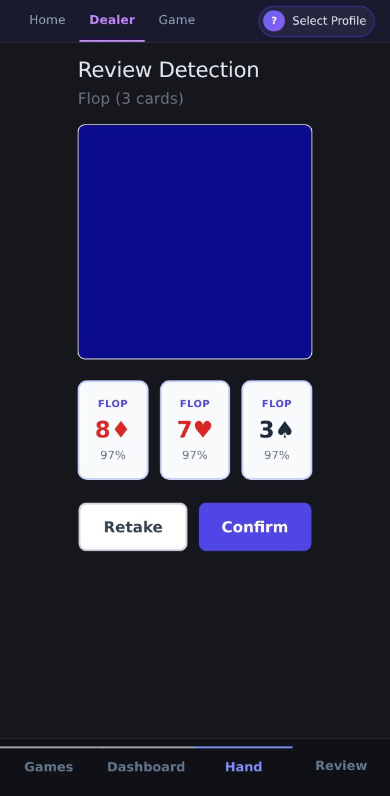</td>
<td>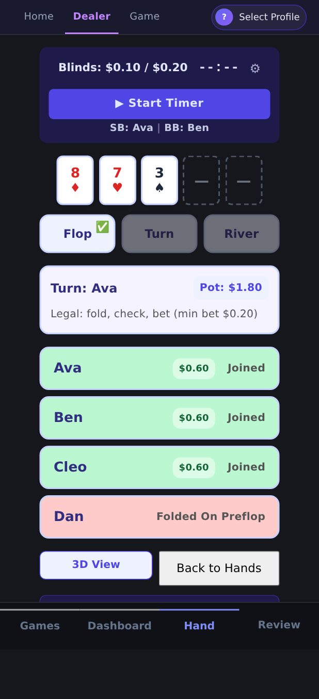</td>
</tr></table>

Betting resumes. After each street's betting the **Turn** and then the
**River** unlock — same process. After the river is bet the banner reads
**"Betting complete — finish the hand"**.

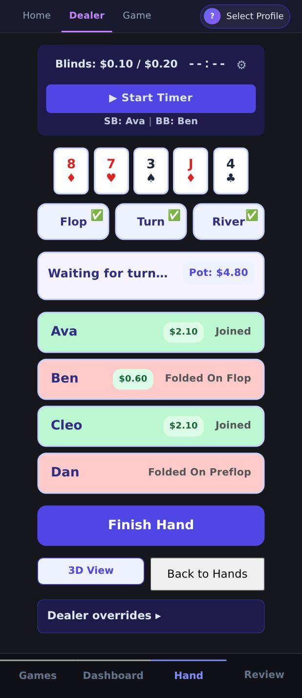

Folded players show in red with the street they folded on.

### 7. Fixing mistakes: dealer overrides (dealer)

Everyone mis-taps eventually. Open **Dealer overrides** under the player list.

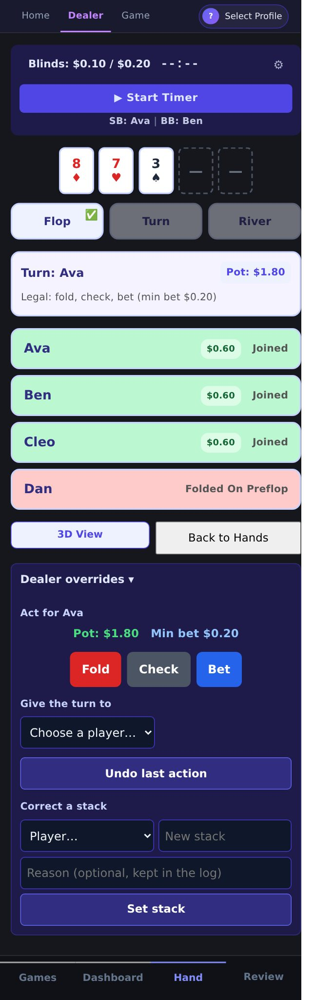

| Control | What it does |
|---------|--------------|
| **Act for *name*** | Fold / check / call / bet on behalf of the player whose turn it is. |
| **Give the turn to** | Hand the turn to a different player. |
| **Undo last action** | Takes back the most recent action — chips and pot go back and the turn returns. Blinds can't be undone. |
| **Correct a stack** | Set a player's stack to the right amount, with an optional reason that is kept in the log. |

### 8. Watch it on the 3D table

Tap **3D View** on the active-hand screen for the table, with each player's
**equity** — their chance of winning the hand from where it stands.

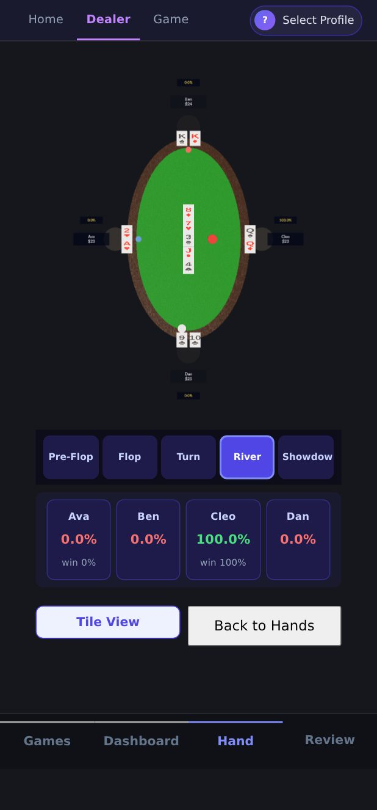

- Equity is **exact** once the flop is down. Before the flop it is a stable
  estimate.
- The street buttons (**Pre-Flop … Showdown**) step back through the hand. The
  view follows the live street on its own until you scrub away.

### 9. Finish the hand and check the payout (dealer)

Tap **Finish Hand**. The review screen lists every player with their cards and
a result: **Won / Lost / Folded**. Check the cards (tap one to correct it) and
mark the winner or winners. The **Payout preview** shows what each player will
win or lose — before anything is saved.

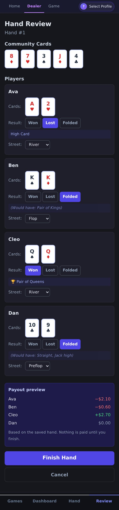

Tap **Finish Hand** and confirm. Stacks update and the hand is saved.

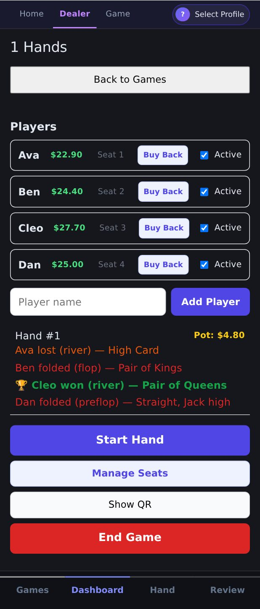

Then **Start Hand** again — the blinds move one seat and the cycle repeats.

### 10. End the game (dealer)

When the night is over tap **End Game**, pick the one or two overall winners
and confirm.

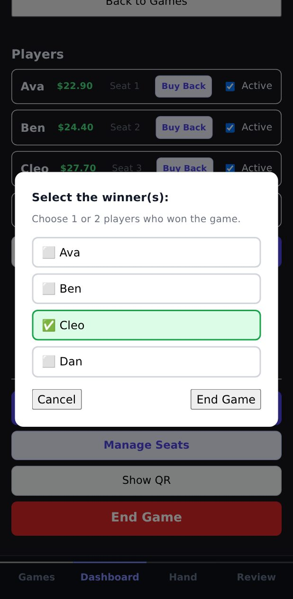

---

## After the game: replay and stats

### Replay a session

Open **Game Sessions** from the home page and tap **▶ Playback**, or go to
`#/playback?gameId=<id>`.

<table><tr>
<td>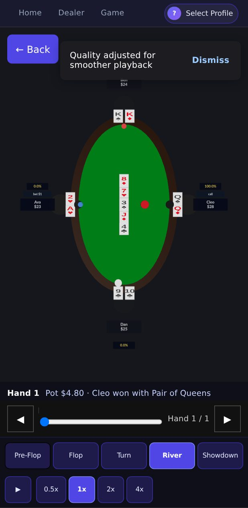</td>
<td>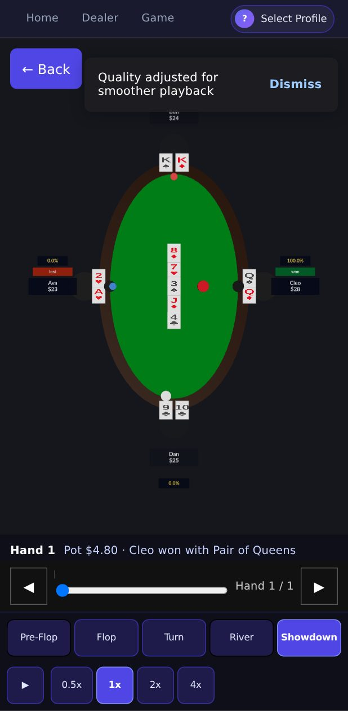</td>
</tr></table>

- The line under the table summarises the hand: the **pot** and **who won with
  what**.
- Move between hands with the slider or ◀ ▶, and step through **Pre-Flop →
  Flop → Turn → River → Showdown**.
- **▶** plays the hand through at 0.5× – 4×.
- Watching a game still in progress? The replay follows it live and stays where
  you put it if you scrub back.

### Your own view of the table

Players can tap **Table View** for the table from their own seat.

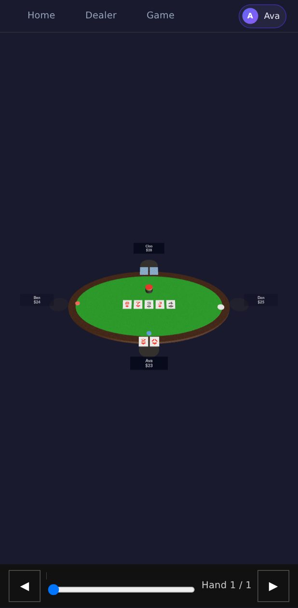

### Leaderboard and stats

The home page ranks everyone by profit and loss, win rate and hands played.
From there: **Head to Head**, **Awards** and **My Stats**.

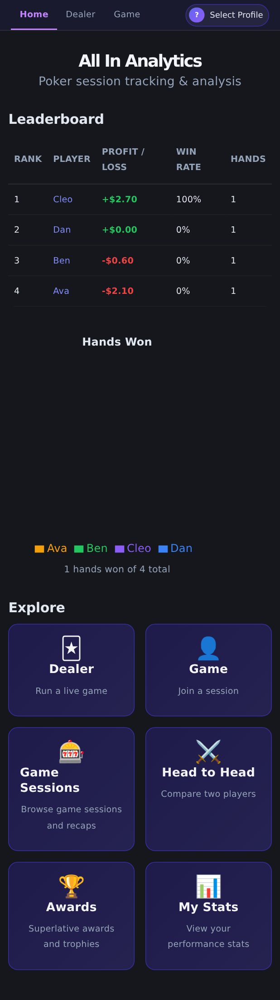

---

## What the app enforces for you

| Rule | What happens |
|------|--------------|
| Turn order | Nobody can act out of turn (only the dealer, via an override). |
| Stacks | You can't bet more than you have; a short call puts you all-in. |
| Minimum bet and raise | Shown on the player's screen; smaller amounts are refused with a reason. |
| All-in and side pots | Players who can't cover a bet are all-in; payouts are worked out per pot. |
| Duplicate cards | The same card can't be in two places. |
| One hand at a time | A new hand can't start until the previous one is settled. |
| Payouts | Worked out by the server in whole cents, so correcting a result never pays twice. |

---

## Tips & troubleshooting

| Issue | What to do |
|-------|------------|
| Phone can't reach the app | Same Wi-Fi as the host? Try `https://<host-ip>`. Guest networks often block device-to-device traffic. |
| Certificate warning | Install the certificate once — see [Getting connected](#getting-connected). |
| Camera won't open | Allow camera access for the site; the page must be `https://`. |
| Card recognised wrongly | Correct the card in the review, or **Retake**. |
| "Reconnecting…" notice | Live updates dropped; the screen catches up when the connection returns. |
| Start Hand says a hand is in progress | Finish or delete that hand first. |
| A stack or action is wrong | Dealer overrides → **Correct a stack** / **Undo last action**. |

---

## Quick reference

| Route | View | Who uses it |
|-------|------|-------------|
| `#/` | Home, leaderboard | Everyone |
| `#/dealer` | Run a game | Dealer |
| `#/player` | Join a game, capture cards, bet | Players |
| `#/player/table?game=<id>&player=<name>` | Your own table view | Players |
| `#/playback?gameId=<id>` | Replay (live for a game in progress) | Anyone |
| `#/data` | Game sessions, CSV import/export | Anyone |

*The screenshots come from a script that plays a mock game against a
throwaway copy of the app (`scripts/docs/`), so they can be regenerated
whenever the design changes.*
